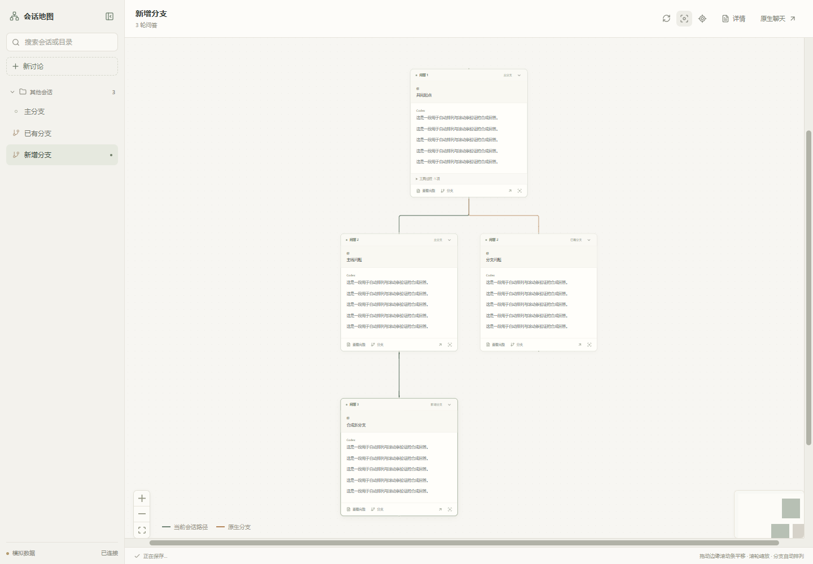

<!-- README_SYNC: source=working-tree-v0.3.4; updated=2026-10-25 -->
<p align="center"><a href="./README.md">简体中文</a> · English</p>

# Codex Synapse · Conversation Canvas

An unofficial Windows Codex desktop adaptation that maps turns and historical forks onto a canvas, with a switch above native chat.

> **Originality disclosure: I am not the original creator of the conversation-map concept or the original plugin.** This project takes direct inspiration from **liangmianya's dsh-synapse**, with AI-assisted Codex integration and local UI implementation. Please credit and support the original author first. This is neither an official port by the original author nor an OpenAI product.
>
> - Original author: [liangmianya on GitHub](https://github.com/liangmianya)
> - Original project: [liangmianya/dsh-synapse](https://github.com/liangmianya/dsh-synapse)
> - Original author's Douyin video: [Hand-building a plugin that turns AI conversations into a map, version 2.0](https://v.douyin.com/5FNvWpwv4eU/)

If this adaptation helps, [star it for later](https://github.com/g1066295317-jpg/codex-synapse/stargazers) and consider [starring the original project](https://github.com/liangmianya/dsh-synapse/stargazers).

[](./package.json)
[](#quick-start)
[](./package.json)
[](./LICENSE)



*Actual interface with synthetic data and no private conversations. The Douyin URL is the user-supplied original video share link, not a verified author profile. See [ATTRIBUTION.md](./ATTRIBUTION.md).*

## Features

- **Switch above native chat**: the enhanced launcher automatically mounts the conversation/canvas switch while keeping native chat available.
- **Explore turns and forks**: group and search local sessions by project/directory, branch from historical turns or quote original answers in follow-ups.
- **Fixed automatic layout**: nodes cannot be dragged; new branches arrange themselves. The wheel zooms, bottom/right bars pan, and selecting branches preserves zoom.
- **Markdown and equations**: code blocks and local KaTeX, supporting `$...$`, `$$...$$`, `\(...\)` and `\[...\]`.
- **Existing session service**: use `codex app-server` without directly rewriting Codex SQLite or JSONL files.

## Quick start

Requires **Windows, Node.js 22+, and an installed, signed-in Codex desktop client with its CLI**. This UI injection relies on internal DOM and routing details and may break after client updates. Debugging binds to `127.0.0.1` and controls the enhanced window: **use only on a trusted local machine**.

1. Download the source ZIP and extract it to a fixed writable local directory. Included `dist/` bundles run without npm dependency installation.
2. Double-click `演示验收.vbs` to explore synthetic sessions first. Demo mode sends no messages to real chats.
3. Double-click `打开会话画布.vbs` to open the enhanced client, then use the switch above chat.
4. To use your usual icon, follow [shortcut setup and restore](./docs/shortcut.md): back up the original shortcut before pointing it at the locally built launcher.

For diagnostic output, run from the extracted directory:

```powershell
powershell.exe -NoProfile -ExecutionPolicy Bypass -File .\scripts\launch-native.ps1 -Foreground
```

The execution-policy override applies only to that launch. Codex, Node.js, accounts and login credentials are not included.

## Interaction

Click a node to read a turn. Continue the latest turn in the same session or fork a historical turn/quoted answer. Sending uses your existing account and configuration. Handle tool approvals explicitly or return to native chat.

The wheel zooms; bottom/right bars pan. Locate-current-turn preserves zoom, while fit-to-canvas deliberately changes it. Nodes are fixed and layout is automatic.

Forks share the working directory and **do not create Git worktrees**. Use Codex worktrees for isolated code changes. Only locally accessible Codex sessions are covered, excluding ChatGPT cloud conversations and other hosts.

## Architecture

```text
Windows launch script / C# launcher
  -> Node controller (runtime/controller.mjs)
  -> Enhanced window + topbar injection (runtime/native-host.mjs)
  -> React Flow canvas (src/NativeWorkspace.jsx)
  -> Restricted backend (server/native-backend.mjs)
  -> codex app-server -> Codex-managed conversations

Viewport, folding, drafts -> data/local/canvas/
Enhanced browser state -> data/local/client-profile/
```

Native sessions remain the source of truth. The Codex integration and UI are implemented separately from DeepSeek Harness. No proprietary Codex installer or extracted client assets are distributed.

## Development and validation

```powershell
npm ci
npm run build
npm test
npm run build:launcher
```

`build:launcher` uses the Windows .NET Framework 4.x C# compiler to create `CodexSynapseLauncher.exe`, which activates an existing enhanced window or starts one. See [CodexSynapseLauncher.cs](./CodexSynapseLauncher.cs).

As of 2026-10-25, **53 synthetic tests pass locally**, covering historical-fork parameters, quotes, approvals, state, equations/fonts, viewport preservation, scrollbars, fixed nodes and automatic layout. Browser tests need Playwright Chromium or installed Chrome / Edge. Without a browser they are skipped; skipped tests must not count as passes.

Native topbar mounting, switching, returning to sessions, reload recovery and shortcut launch were verified locally. **Real-account model generation and fork creation have not been tested end to end**; those interactions use synthetic backends in tests. Default tests send no real messages and create no real chats. No cross-version compatibility or coverage percentage is claimed.

## Compatibility and data boundaries

- Checked locally with `OpenAI.Codex_26.1021.3705.0`, CLI `0.164.0-alpha.11.1`, Node.js `24.14.1`. Other versions require verification; only Windows launch scripts are provided.
- Ordinary Codex entries do not load the canvas. Use the enhanced launcher or connect a backed-up shortcut as documented. Shortcuts are never changed automatically.
- Installed client files and session databases are not directly modified. Closing the canvas does not delete chats. Math and fonts are bundled locally; the canvas has no telemetry or remote scripts.
- Existing `CODEX_HOME` and login configuration are used. After launch, `data/` may contain chat identifiers, drafts, logs and browser login state. **Never share an entire used runtime directory**. Exclude `data/`, `.synapse/`, logs and environment files from source releases.
- Browsing sessions does not call a model. Sending uses existing account/tool permissions. Unknown approval formats are rejected and commands are not automatically approved. Codex retains its own network behavior.
- View images, non-text attachments and complex client operations in native chat. Never expose the debugging port to the public internet.
- The repository retains its existing [MIT license](./LICENSE). Upstream and dependencies retain their own licenses; see [attribution](./ATTRIBUTION.md) and [third-party notices](./dist/THIRD_PARTY_NOTICES.txt).

Report problems via [Issues](https://github.com/g1066295317-jpg/codex-synapse/issues) with versions and redacted errors. [Star this adaptation](https://github.com/g1066295317-jpg/codex-synapse/stargazers) for later, and visit [dsh-synapse](https://github.com/liangmianya/dsh-synapse) to support the original author.

